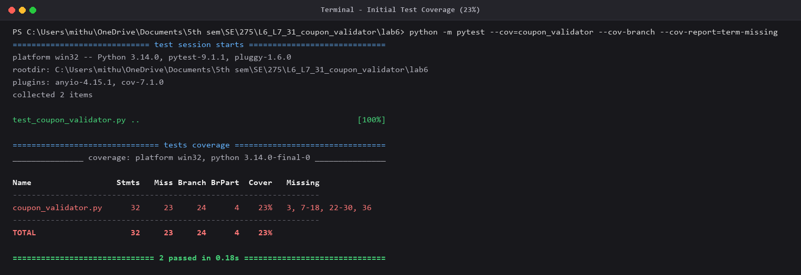
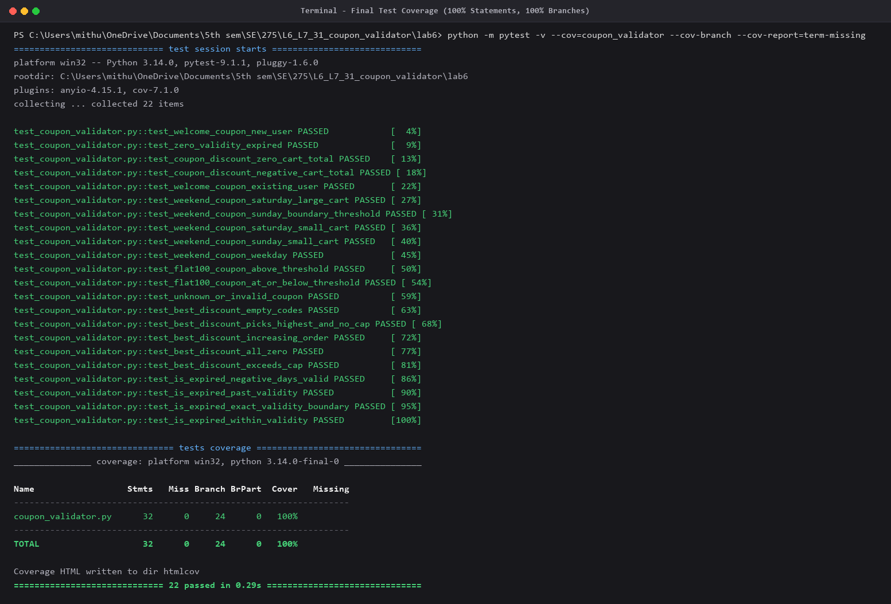
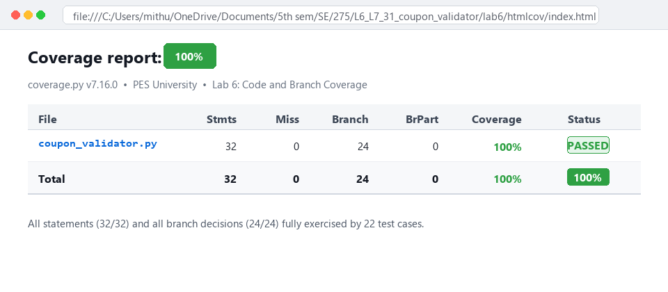
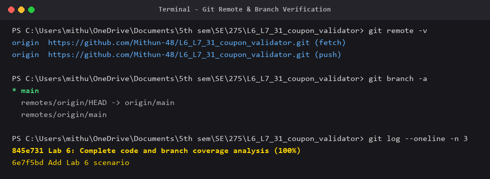

# Lab 6: Code and Branch Coverage Analysis

## Student Details
- **Student Name:** Mithun Naik
- **SRN:** PES2UG24CS277
- **Course:** Software Engineering (UE24CS351A)
- **Repository (Fork):** [https://github.com/Mithun-48/L6_L7_31_coupon_validator](https://github.com/Mithun-48/L6_L7_31_coupon_validator)
- **Upstream Repository:** [https://github.com/SETAPESU26/L6_L7_31_coupon_validator](https://github.com/SETAPESU26/L6_L7_31_coupon_validator)
- **Branch:** `main`

---

## 1. Overview
This lab focuses on performing code coverage and branch coverage analysis on the `coupon_validator` module using `pytest` and `pytest-cov` (`coverage.py`).

The starter test suite contained only 2 test cases achieving **23%** coverage with significant unexercised statements and partial branches. The test suite has been extended to 22 thorough test cases achieving **100% statement coverage** (32/32 statements) and **100% branch coverage** (24/24 branch decisions).

---

## 2. Coverage Metrics Comparison

| Metric | Starter Test Suite | Improved Test Suite | Improvement |
|:---|:---:|:---:|:---:|
| **Total Test Cases** | 2 | **22** | +20 tests |
| **Statements Total** | 32 | 32 | - |
| **Statements Covered** | 9 | **32** | +23 |
| **Statements Missed** | 23 | **0** | -23 |
| **Statement Coverage %** | 28% | **100%** | **+72%** |
| **Branch Decisions Total** | 24 | 24 | - |
| **Partial Branches Missed** | 4 | **0** | -4 |
| **Overall Code & Branch Coverage** | **23%** | **100%** | **+77%** |

---

## 3. Detailed Branch Analysis & Test Mapping

The `coupon_validator.py` module contains 3 primary functions. Every decision gate and boundary condition was analyzed and exercised:

### Function 1: `coupon_discount(code, cart_total, is_new_user, day)`

| Branch / Condition | Target Outcome | Test Function | Inputs / Condition | Expected Result |
|:---|:---|:---|:---|:---|
| `cart_total <= 0` | True (Boundary: 0) | `test_coupon_discount_zero_cart_total` | `cart_total = 0` | Raises `ValueError("empty cart")` |
| `cart_total <= 0` | True (Negative) | `test_coupon_discount_negative_cart_total` | `cart_total = -50` | Raises `ValueError("empty cart")` |
| `cart_total <= 0` | False | All positive cart tests | `cart_total > 0` | Proceeds to coupon evaluation |
| `code == "WELCOME10"` | True (`is_new_user=True`) | `test_welcome_coupon_new_user` | `200`, `True`, `"mon"` | `20.0` (10% of 200) |
| `code == "WELCOME10"` | True (`is_new_user=False`) | `test_welcome_coupon_existing_user` | `200`, `False`, `"mon"` | `0` |
| `code == "WELCOME10"` | False | All non-WELCOME10 tests | Other codes | Proceeds to next coupon check |
| `code == "WEEKEND20"` | True (`day in ("sat", "sun")`, `cart_total >= 500`) | `test_weekend_coupon_saturday_large_cart` | `600`, `False`, `"sat"` | `120.0` (20% of 600) |
| `code == "WEEKEND20"` | True (`day == "sun"`, `cart_total == 500` boundary) | `test_weekend_coupon_sunday_boundary_threshold` | `500`, `False`, `"sun"` | `100.0` (20% of 500) |
| `code == "WEEKEND20"` | True (`day == "sat"`, `cart_total < 500`) | `test_weekend_coupon_saturday_small_cart` | `400`, `False`, `"sat"` | `50` (flat 50) |
| `code == "WEEKEND20"` | True (`day == "sun"`, `cart_total == 499` boundary) | `test_weekend_coupon_sunday_small_cart` | `499`, `False`, `"sun"` | `50` (flat 50) |
| `code == "WEEKEND20"` | True (`day not in weekend`) | `test_weekend_coupon_weekday` | `600`, `False`, `"fri"` / `"wed"` | `0` |
| `code == "WEEKEND20"` | False | All non-WEEKEND20 tests | Other codes | Proceeds to next coupon check |
| `code == "FLAT100"` | True (`cart_total > 300`) | `test_flat100_coupon_above_threshold` | `301` / `500`, `"mon"` | `100` |
| `code == "FLAT100"` | True (`cart_total <= 300` boundary & below) | `test_flat100_coupon_at_or_below_threshold` | `300` / `150`, `"mon"` | `0` |
| `code == "FLAT100"` | False | Default / other tests | Non-FLAT100 | Proceeds to fallback |
| Unrecognized coupon | Default fallthrough | `test_unknown_or_invalid_coupon` | `"UNKNOWN"`, `""` | `0` |

### Function 2: `best_discount(codes, cart_total, is_new_user, day)`

| Branch / Condition | Target Outcome | Test Function | Inputs / Condition | Expected Result |
|:---|:---|:---|:---|:---|
| `for code in codes` | Empty list (loop skipped) | `test_best_discount_empty_codes` | `codes = []` | `0` |
| `value > best` | True (updates `best`) | `test_best_discount_increasing_order` | `["WELCOME10", "FLAT100"]` | Updates `best` to `100` |
| `value > best` | False (does not update `best`) | `test_best_discount_picks_highest_and_no_cap` | `["FLAT100", "WELCOME10"]` | `best` stays `100` |
| All discounts 0 | `best` remains 0 | `test_best_discount_all_zero` | Ineligible coupons | `0` |
| `best > cap` (`cap = cart_total * 0.4`) | True (capped discount) | `test_best_discount_exceeds_cap` | `["WEEKEND20"]`, `cart_total=100`, `"sat"` (best=50 > cap=40) | `40` |
| `best > cap` | False (within cap) | `test_best_discount_picks_highest_and_no_cap` | `cart_total=400`, `best=100 <= cap=160` | `100` |

### Function 3: `is_expired(today, start, days_valid)`

| Branch / Condition | Target Outcome | Test Function | Inputs / Condition | Expected Result |
|:---|:---|:---|:---|:---|
| `days_valid <= 0` | True (`days_valid == 0`) | `test_zero_validity_expired` | `10, 5, 0` | `True` |
| `days_valid <= 0` | True (`days_valid < 0`) | `test_is_expired_negative_days_valid` | `10, 5, -2` | `True` |
| `today - start > days_valid` | True (`today - start > days_valid`) | `test_is_expired_past_validity` | `10, 2, 5` ($10-2 = 8 > 5$) | `True` (expired) |
| `today - start > days_valid` | False (Boundary: `today - start == days_valid`) | `test_is_expired_exact_validity_boundary` | `10, 5, 5` ($10-5 = 5$, not $> 5$) | `False` (valid) |
| `today - start > days_valid` | False (Within validity: `today - start < days_valid`) | `test_is_expired_within_validity` | `8, 5, 5` ($8-5 = 3 < 5$) | `False` (valid) |

---

## 4. Execution & Verification

### Running the Tests
To execute all test cases with statement and branch coverage reporting:
```bash
python -m pytest -v --cov=coupon_validator --cov-branch --cov-report=term-missing --cov-report=html
```

---

## 5. Deliverables & Screenshots

### 1. Initial Test Coverage (23%)


### 2. Final Test Coverage (100% Statements, 100% Branches)


### 3. HTML Coverage Report Summary (100% Overall)


### 4. Git Remote and Branch Verification

